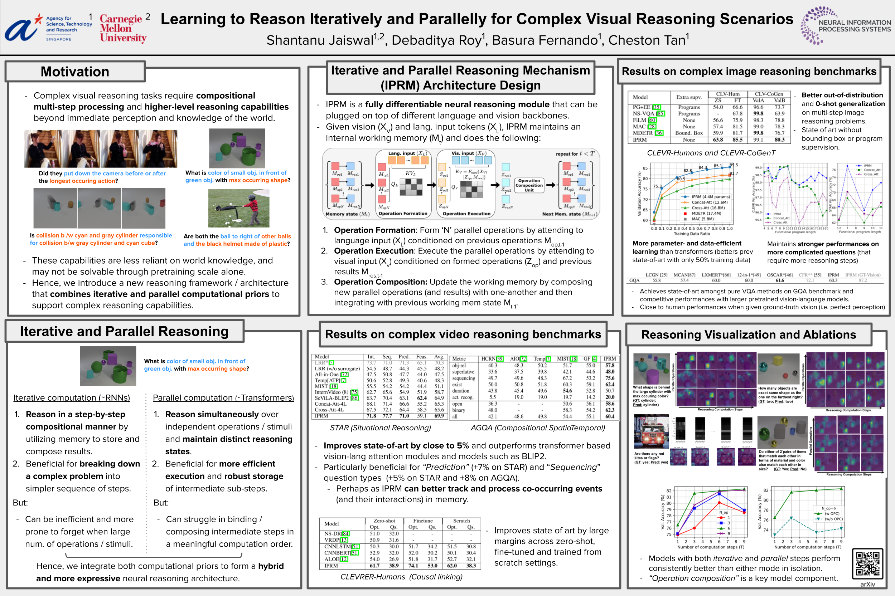

# "Learning to Reason Iteratively and Parallelly for Complex Visual Reasoning Scenarios"

- PyTorch implementation for paper **"Learning to Reason Iteratively and Parallelly for Complex Visual Reasoning Scenarios"** (NeurIPS 2024; [paper](https://arxiv.org/abs/2411.13754)).



## Code environment

The codebase and associated experiments are performed in following environment:
- OS: Linux 5.15.0-76-generic (Ubuntu 20.04.4 LTS, x86_64)
- Python: 3.8.10 (GCC 9.4.0)
- GPU: NVIDIA A40 and NVIDIA A6000
- Python packages/toolkits: See [`requirements.txt`](requirements.txt). Incase of errors with lavis library please use [`requirements_alt.txt`](requirements_alt.txt)

To run code, ideally create a virtual/conda environment and install requirements listed in [`requirements.txt`](requirements.txt) by running:
```bash
pip install -r requirements.txt
```

## Usage

Code for IPRM module and VLM model design for imageQA and videoQA are provided. Checkpoints and other supporting model backbone components are available here: [drive link](https://drive.google.com/drive/folders/1wJZwC8qyzOM7nRZj_tlIJC96fkgY4AHW?usp=sharing).

### ImageQA
To train models for imageQA, please refer to `imageQA` directory and run:
```bash
python train_main.py --config=configs/m6_t9.yaml
```

For example visualization, see attached `Visualization_framework.ipynb`
For more details, see [`imageQA/instructions.md`](imageQA/instructions.md).

### VideoQA
To train models for videoQA, please refer to `videoQA` directory and run for example:
```bash
python train_main.py --config=configs/star_iprm_m6_t9.yaml
```
For more details, see [`videoQA/instructions.md`](videoQA/instructions.md).

## Acknowledgement

The codebase uses the following repositories:
1. For NLVRv2 and the base VQA language embeddings (https://github.com/salesforce/LAVIS)
2. For CLEVR dataset and feature extraction (https://github.com/ceyzaguirre4/DACT-MAC)
3. For GQA dataset VinVL feature extraction (https://github.com/pzzhang/VinVL)
4. For STAR and AGQA video scene graph feature extraction (https://github.com/yrcong/STTran)


## Citation
If you find the work or codebase useful, please consider citing:
```bibtex
@article{jaiswal2024learning,
  title={Learning to reason iteratively and parallelly for complex visual reasoning scenarios},
  author={Jaiswal, Shantanu and Roy, Debaditya and Fernando, Basura and Tan, Cheston},
  journal={Advances in Neural Information Processing Systems},
  volume={37},
  pages={137965--137998},
  year={2024}
}

```

## License

This project's codebase is released under the MIT license. Please see the [LICENSE](LICENSE) file for more information.

## Contact Information

In case of any suggestions or questions, please leave a message here or contact me directly at sjaiswa3@cs.cmu.edu, thanks!
